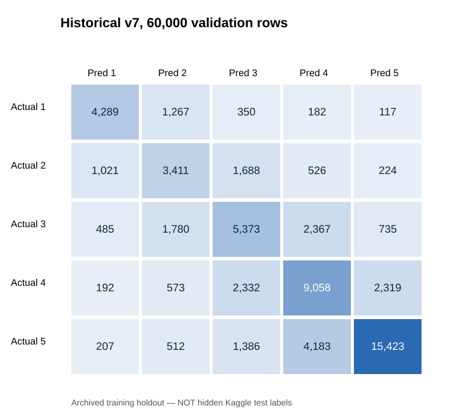

# Audit dan confusion matrix historis, 14 Oktober 2026

Dataset asli: 533.465 train / 228.629 test. Checkpoint eksternal: `Structural_Damage_NonNeural_Rebuild_Checkpoint.zip` (arsip besar tidak disimpan di repo). Hash SHA-256 `train.csv`: `231c9bf0430faa9c1d2281b4edbcd9ce0d7a863c6ff67042a8fbc992469d37bb`.

## Hasil yang diperiksa ulang dari file prediksi dan label asli

| Eksperimen | N | Accuracy | Macro F1 |
|---|---:|---:|---:|
| Historis v6 | 60.000 | 0,624517 | 0,6007956704 |
| Historis v7 | 60.000 | 0,625900 | 0,6011981356 |
| Checkpoint 012 (parsial, 3 LightGBM) | 32.009 | 0,621825 | 0,595706 |

Pemeriksaan arsip v6/v7 mencocokkan 60.000 indeks ke target data asli, memeriksa bahwa 3 fold masing-masing 20.000 baris menyusun pooled predictions, dan menghitung ulang Macro F1. Checkpoint 012 hanya memuat prediksi tiga LightGBM dan tidak memiliki checkpoint CatBoost atau full refit; skor parsial ini diperoleh dari pilihan bobot/koreksi pada CAL dan SEL, lalu diukur di bagian AUDIT. Tidak identik dengan eksperimen akhir 012.

## Confusion matrix historis v7 (counts)

Baris menunjukkan **kelas aktual**, kolom menunjukkan **kelas prediksi**.

| Aktual / Prediksi | G1 | G2 | G3 | G4 | G5 |
|---|---:|---:|---:|---:|---:|
| G1 | 4289 | 1267 | 350 | 182 | 117 |
| G2 | 1021 | 3411 | 1688 | 526 | 224 |
| G3 | 485 | 1780 | 5373 | 2367 | 735 |
| G4 | 192 | 573 | 2332 | 9058 | 2319 |
| G5 | 207 | 512 | 1386 | 4183 | 15423 |

**Macro F1 = 0,601198**, accuracy 0,625900. **F1 per grade**: G1=0,69183, G2=0,47332, G3=0,49138, G4=0,58837, G5=0,76108. Kesalahan menonjol: Grade 2→3 (1.688) dan Grade 3→2 (1.780); Grade 4→5 (2.319) dan Grade 5→4 (4.183). Model kesulitan membedakan kelas kerusakan menengah.



## Reproduksi eksperimen baru

Jalankan notebook [07_standalone_reproduction.ipynb](../notebooks/07_standalone_reproduction.ipynb). Notebook menanam semua fungsi, termasuk `Pipeline`, `ColumnTransformer`, lightGBM/CatBoost, audit, confusion plot, model full refit, joblib, dan replay CSV byte-identical. Input cukup ZIP asli + packages. `QUICK=False` untuk full run, `QUICK=True` hanya smoke test. Kandidat barunya **bukan** reproduksi eksak submission 010, dan skornya di Kaggle belum diketahui.

Audit terhadap arsip historis dapat diulang dengan:
```bash
python -m scripts.historical_checkpoint_audit --data data/structural-damage-classification.zip --checkpoint Structural_Damage_NonNeural_Rebuild_Checkpoint.zip
```

### Batas ilmiah

- v6/v7 adalah *historically adaptive confirmation* karena hasil fold pernah dipakai untuk memilih model; skornya tidak boleh diiklankan sebagai validasi independen yang murni.
- CSV submit 010/011 sendiri tidak menyimpan lengkap ensemble/model state historis yang menciptakannya. Byte-exact reproduction dari raw-data-only untuk 010 belum dibuktikan.
- Hidden label Kaggle test tidak tersedia. Confusion matrix 228.629 baris test secara sah tidak dapat dibuat.
- Model baru tetap non-neural; tidak ada neural network.
