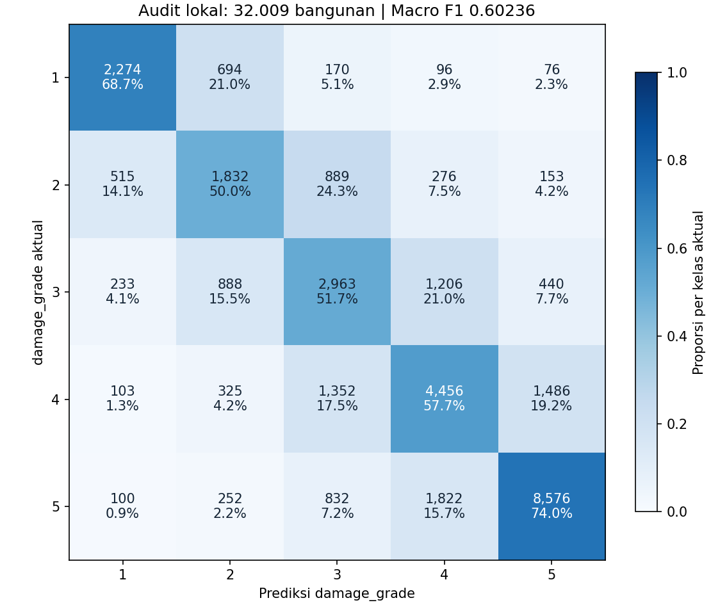

# Eksperimen ulang setelah audit kebocoran data

## Hasil dan keputusan

Kandidat baru `012_Constantine_leakage_fixed.csv` dihasilkan dari pelatihan ulang, bukan dari penggantian nama CSV lama. Macro F1 seleksi adalah **0.597649**, sedangkan Macro F1 evaluasi akhir adalah **0.602359**. Skor Kaggle kandidat ini belum diketahui. Submission ke-10 dengan skor publik 0,60627 tetap menjadi acuan terbaik yang telah dilaporkan.

Angka validasi pada split baru tidak dapat langsung dibandingkan dengan angka validasi eksperimen historis atau skor public leaderboard. Data historis sudah sering dipakai dalam eksperimen. Karena itu bagian audit ini hanya disebut tidak dipakai untuk seleksi dalam run ini, bukan data yang belum pernah dilihat dalam seluruh riwayat proyek.

## Apa yang diperbaiki

- Statistik jumlah dan rata-rata kelompok dihitung pada bagian fit. Baris test dan validasi tidak ikut membentuk statistik tersebut.
- Fitur ID numerik utuh dihapus. Prefix dan urutan parsial ID masih digunakan sebagai hipotesis kedekatan survei, bukan sebagai koordinat geografis yang terverifikasi.
- Label tetangga dibentuk secara cross-fitting tiga lipatan. Untuk setiap baris latih, seluruh lipatannya dikeluarkan dari referensi. TargetEncoder multiclass juga menggunakan cross-fitting internal.
- Kalibrasi offset kelas, pemilihan model, dan evaluasi akhir mempunyai bagian data yang berbeda. Tidak ada offset yang disesuaikan memakai skor Kaggle kandidat ini.
- Pipeline dan ColumnTransformer tersedia dalam implementasi. Prediksi disimpan bersama konfigurasi, indeks split, probabilitas, dan model terlatih agar hasil dapat ditelusuri.

## Pembagian data

| Bagian | Baris | Fungsi |
|---|---:|---|
| fit | 426,772 | Pelatihan dan cross-fitting |
| calibration | 37,342 | Early stopping dan kalibrasi kelas |
| selection | 37,342 | Memilih model, bobot, dan kekuatan kalibrasi |
| audit | 32,009 | Evaluasi satu kali setelah keputusan dikunci |

Tiga konfigurasi LightGBM dan satu CatBoost numerik dilatih. CatBoost di sini menerima keluaran numerik dari ColumnTransformer, termasuk target encoding; bukan konfigurasi categorical-native. Ada 23 resep probabilitas (model tunggal, pasangan, dan rata-rata semua model), masing-masing diuji dengan tiga kekuatan kalibrasi, sehingga total 69 kandidat keputusan pada bagian seleksi.

## Kandidat teratas pada bagian seleksi

| Bobot model | Macro F1 seleksi | Macro F1 kalibrasi |
|---|---:|---:|
| {"lgb47": 0.25, "cat_numeric": 0.75} | 0.597649 | 0.602895 |
| {"lgb31_weighted": 0.25, "cat_numeric": 0.75} | 0.597579 | 0.603307 |
| {"lgb95": 0.25, "cat_numeric": 0.75} | 0.597495 | 0.603154 |
| {"lgb95": 0.25, "cat_numeric": 0.75} | 0.597284 | 0.600500 |
| {"cat_numeric": 1.0} | 0.597250 | 0.600162 |
| {"lgb31_weighted": 0.25, "cat_numeric": 0.75} | 0.597184 | 0.600367 |
| {"lgb47": 0.5, "cat_numeric": 0.5} | 0.596970 | 0.600585 |
| {"lgb47": 0.25, "cat_numeric": 0.75} | 0.596618 | 0.600508 |

Offset log-probabilitas pemenang: `[-0.13400000000000004, 0.196, 0.14600000000000002, -0.003999999999999988, -0.20400000000000001]`.

## Evaluasi akhir



| Kelas | Precision | Recall | F1 | Support |
|---|---:|---:|---:|---:|
| 1 | 0.7051 | 0.6870 | 0.6959 | 3310 |
| 2 | 0.4590 | 0.4999 | 0.4786 | 3665 |
| 3 | 0.4774 | 0.5171 | 0.4965 | 5730 |
| 4 | 0.5672 | 0.5771 | 0.5721 | 7722 |
| 5 | 0.7992 | 0.7405 | 0.7687 | 11582 |

Baseline LightGBM 47 daun tanpa kalibrasi pada audit yang sama: **0.590189**. Selisih kandidat: **+0.012170**. Interval bootstrap berpasangan berdasarkan prefix enam digit, 500 pengulangan: `[0.00858368675062399, 0.01571088070118554]`. Perbandingan ini terhadap baseline run baru, bukan terhadap submission ke-10.

Bootstrap tersebut bersyarat pada resep terpilih. Ia tidak mengoreksi keseluruhan pencarian historis. Prefix digunakan sebagai proxy kelompok, bukan bukti bahwa setiap kelompok benar-benar satu unit geografis.

Confusion matrix: baris adalah kelas aktual, kolom adalah prediksi kelas 1–5.

| Aktual | 1 | 2 | 3 | 4 | 5 |
|---|---:|---:|---:|---:|---:|
| 1 | 2274 | 694 | 170 | 96 | 76 |
| 2 | 515 | 1832 | 889 | 276 | 153 |
| 3 | 233 | 888 | 2963 | 1206 | 440 |
| 4 | 103 | 325 | 1352 | 4456 | 1486 |
| 5 | 100 | 252 | 832 | 1822 | 8576 |

## Interpretasi fitur

Fitur label tetangga menyumbang 57.1% dari importance internal yang dinormalisasi lalu dibobotkan mengikuti ensemble. Angka ini bersifat deskriptif: importance gain LightGBM dan importance CatBoost berbeda definisi, sehingga bukan ukuran kausal atau kontribusi F1.
Fitur teratas `neighbor_10` adalah probabilitas kelas 5 dari tetangga dengan bandwidth urutan ID 10 dan penalti perbedaan fisik pangkat 2. `neighbor_21` dan `neighbor_20` mewakili kelas 4 dan kelas 3 pada bandwidth 100, dengan penalti yang sama. Dominasi fitur tersebut konsisten dengan penurunan performa pada stress test wilayah baru. Kedekatan urutan ID tidak membuktikan jarak fisik sebenarnya.


## Sumber kenaikan dan kesalahan tersisa

| Kelas | F1 baseline | F1 kandidat | Selisih |
|---|---:|---:|---:|
| 1 | 0.697878 | 0.695945 | -0.001933 |
| 2 | 0.446014 | 0.478579 | +0.032565 |
| 3 | 0.476726 | 0.496481 | +0.019756 |
| 4 | 0.560479 | 0.572089 | +0.011610 |
| 5 | 0.769848 | 0.768700 | -0.001148 |

Dari 11,908 kesalahan, 8,852 (74.3%) hanya berbeda satu tingkat. Kandidat memperbaiki 1,252 kesalahan baseline, tetapi mengubah 1,163 prediksi baseline yang benar menjadi salah. Peningkatan Macro F1 terutama berasal dari keseimbangan kelas 2–4, bukan lonjakan accuracy.

Diagnostik menurut material, fondasi, dan distrik tersedia di `subgroup_diagnostics.csv`. Kelompok ditampilkan bila memiliki minimal 200 baris audit; recall kelas 2/3 hanya ditampilkan bila support kelas tersebut minimal 50. Perbedaan distribusi kelas membuat accuracy antarkelompok tidak langsung sebanding. Ini analisis deskriptif setelah seleksi, bukan dasar penyetelan model atau kesimpulan kausal.

Dua kelas dengan F1 terendah dalam run ini adalah kelas 2 dan 3. Kenaikan selanjutnya perlu dinilai dari kesalahan kelas ini, bukan hanya accuracy atau perubahan jumlah label test.

## Pemeriksaan kebocoran dan batasnya

- Uji perubahan komposisi batch prediksi lolos: menambahkan baris lain tidak mengubah fitur baris lama.
- Kolom label palsu pada query tidak mengubah fitur. Kolom full building_id dan id_numeric tidak masuk ke classifier.
- Kontrol label acak pada 8,000 baris menghasilkan Macro F1 0.203019; kontrol mayoritas 0.106530. Hasil rendah ini konsisten dengan tidak adanya jalan pintas target yang jelas pada kontrol tersebut. Ini bukan sertifikat bebas kebocoran.
- Diagnostik geografis pada sampel 60,000 baris, dengan jumlah fit dan holdout yang sama, menghasilkan Macro F1 0.518197 pada split acak dan 0.441427 pada split prefix6 yang terpisah seluruhnya. Distribusi kelas kedua holdout berbeda. Penurunan ini menunjukkan ketergantungan pada pola lokal, bukan ukuran langsung kebocoran atau estimasi penurunan skor Kaggle. Diagnostik ini tidak dipakai memilih kandidat.
- Sebanyak 100.0% baris test memiliki prefix6 yang sudah ada pada train. Ada 5,666 prefix6 pada train, dan masing-masing berada dalam satu ward_id. Karena cakupan wilayah test tumpang tindih dengan train, stress test wilayah baru menguji skenario yang lebih sulit dan berbeda, bukan pengganti langsung validasi untuk kompetisi ini.
- Referensi tetangga saat cross-fitting lebih kecil daripada saat inferensi. Perubahan kepadatan referensi dapat menimbulkan pergeseran fitur walaupun label tidak bocor.
- Early stopping dan offset memakai bagian kalibrasi yang sama. Bagian seleksi terpisah mengurangi risiko memilih kalibrasi yang hanya bagus di sana; audit tetap diperlukan.
- Menambah iterasi sampai satu angka validasi mencapai 0,65 berisiko menyesuaikan model terhadap noise. Protokol run ini dikunci sebelum hasil audit dilihat. Tidak ada klaim target 0,65 sudah tercapai.

## Integritas CSV

Replay dari bundle tersimpan pada seluruh 228.629 baris test menghasilkan CSV yang identik byte demi byte. Pemeriksaan terpisah pada 64 baris juga mencocokkan Pipeline mentah dengan probabilitas tersimpan (selisih maksimum sekitar 2,97e-8). Bukti: `bundle_verification.json`. Ini membuktikan replay dari model tersimpan, bukan bahwa training dari awal lintas mesin pasti menghasilkan byte yang sama.

CSV berisi 228.629 baris dengan header `building_id,damage_grade`, ID unik sesuai urutan sample submission, dan label integer 1–5. Ada 20,831 prediksi yang berbeda dari submission ke-10.

SHA256: `b10072cca29ffbfa36d07228d1000139054cfc17193f2f61aedc7a8d3c73a396`.

Jumlah prediksi per kelas: `{'1': 23149, '2': 28945, '3': 44317, '4': 54875, '5': 77343}`.

## Menjalankan ulang

```bash
python -m scripts.run_fixed_experiment --data data --output artifacts/fixed_run
python -m scripts.check_fixed_control --data data
python -m scripts.check_geographic_stress --data data
python -m scripts.describe_fixed_errors --data data
python -m scripts.verify_fixed_delivery --data data
python -m scripts.summarize_fixed_run
python -m pytest -q tests/test_leakage_fixed.py tests/test_preprocess.py
```

Letakkan CSV asli pada folder data. Untuk kontrol label acak, sesuaikan parameter --data jika memakai lokasi berbeda. Notebook 10 membaca hasil yang benar-benar dihasilkan eksperimen dan menyediakan perintah pelatihan ulang. Bundle model memuat referensi latih sehingga tidak dipublikasikan ke GitHub.

Pelatihan akhir pada run yang diserahkan dilanjutkan melalui `python -m scripts.resume_fixed_refit --data data --threads 8`, memakai resep yang telah dikunci tanpa seleksi ulang. Validasi menggunakan 4 thread, refit menggunakan 8 thread. Model tersimpan dan SHA CSV adalah bukti artefak aktual; kesamaan byte dari pelatihan ulang lintas mesin belum diuji. Log lengkap tahap akhir ada di `refit.log`.

Untuk replay tanpa training, ekstrak checkpoint privat ke `artifacts/fixed_run`, lalu jalankan `python -m scripts.predict_fixed --bundle artifacts/fixed_run/model_bundle.joblib --test data/test.csv --sample data/sample_submission.csv --output artifacts/replayed_012.csv`.

Rekomendasi: uji kandidat CSV ini di Kaggle. Pertahankan submission ke-10 sebagai pilihan terbukti sampai hasil kandidat baru tersedia.
